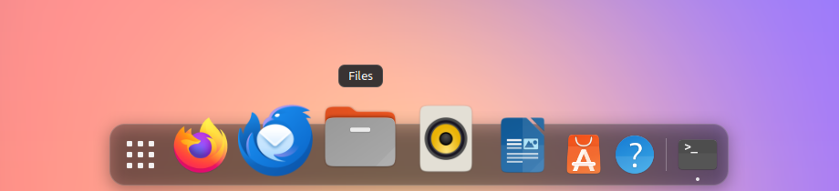

# Pier

A floating dock for GNOME Shell 46–50. Pier keeps your favourite apps one click away, with icons that grow under the pointer, drag-and-drop pinning and reordering, launch animations, running indicators and an autohide that steps out of the way of your windows.



> [!WARNING]
> **AI disclosure: this extension's code is 100% AI-generated.**
>
> Every line of Pier was written by an AI coding assistant. The code was tested, but it has not been independently reviewed or audited line by line, and it may contain bugs, security issues or behaviour nobody intended.
>
> GNOME Shell extensions run inside your desktop session with the same access as the rest of GNOME Shell, so a fault can freeze or crash your desktop. **Proceed with caution and use it at your own risk.** Read the code before installing it, and know how to turn it off: `gnome-extensions disable pier@sanitydub.github.io`, or if your desktop stops responding, switch to a text console (for example `Ctrl+Alt+F3`), log in, run `gsettings set org.gnome.shell disable-user-extensions true` and restart your session.
>
> Pier is provided as is, without any warranty.

## Features

- Floating, rounded, translucent dock with adjustable opacity and an optional frosted-glass background (blurred wallpaper, shaped to the dock's rounded corners)
- Hover magnification with a cosine falloff; neighbouring icons grow too and are pushed apart
- Icons bounce while an app launches
- A dot under each running app
- Windows minimize into their app's dock icon and restore out of it
- Pinned apps (shared with GNOME's favourites), a separator, then other running apps
- Bottom, left or right edge
- Autohide modes:
  - *Never hide*: the dock reserves its strip of the screen, so maximized windows stop above it
  - *Always hide*: hidden until you push the pointer against the screen edge
  - *Hide when a window overlaps* (intellihide): hidden only while a window, maximized or not, covers the dock. Push against the screen edge to reveal it
- Fits into the overview: the dock stays put, the frosted glass fades out as the overview opens, and for a dock at the bottom the desktop card and app grid keep clear of it. With *Never hide*, the strip beside a bottom dock shrinks along with the rest of the desktop
- libadwaita preferences window; changes apply live

GNOME's built-in dash is hidden while the extension is enabled and restored when it is disabled. Pier takes its place in the overview.

## Using the dock

**App icons**

- Click to open or focus an app. Click a focused app again to cycle through its windows, or to minimize it if it has only one
- Middle-click to open a new window
- Right-click for a menu: the app's windows, New Window, Keep in Dock / Remove from Dock, and Quit

**Show Applications button**

- Click to open or close the app grid
- Right-click for **Dock Settings…**, which opens the preferences window

**Drag and drop**

- **Reorder:** press and hold a pinned app for a moment, then drag it along the dock. The other pinned apps slide out of the way, and the new order is saved to GNOME's favourites when you release.
- **Remove:** drag a pinned app off the dock. After half a second a **Remove** label appears next to it; release to remove the app from the dock. Release earlier, drag back over the dock or press Escape to put it back.
- **Add:** drag an app from the overview's app grid onto the dock. A gap opens to show where it will go; release to pin it there. You can also right-click an app in the grid and choose **Pin to Dash**.

Only pinned apps can be dragged. Removing an app shows GNOME's usual "unpinned" notification with an Undo button.

## Installing from source

You need GNOME Shell 46–50, plus `git` and `make`, which a fresh desktop may not have:

```bash
sudo apt install git make     # Ubuntu, Debian
sudo dnf install git make     # Fedora
```

Then:

```bash
git clone https://github.com/sanitydub/pier.git
cd pier
make install
```

`make install` links the extensions folder to this clone rather than copying it, so keep the `pier` folder where it is: if you move or delete it, Pier disappears at your next login. To install a standalone copy instead, run `make pack` and then `gnome-extensions install dist/pier@sanitydub.github.io.shell-extension.zip`, after which the clone can go.

Log out and back in (Wayland can't load new extension code into a running session), then enable it:

```bash
gnome-extensions enable pier@sanitydub.github.io
```

Turn off other docks such as Ubuntu Dock or Dash to Dock while using Pier, or the two will overlap:

```bash
gnome-extensions disable ubuntu-dock@ubuntu.com
```

Open the preferences with `gnome-extensions prefs pier@sanitydub.github.io`, or right-click the Show Applications button.

To update a clone installed with `make install`, run `git pull` and `make install` in the `pier` folder, then log out and back in.

## Development

You need GNOME 46 or newer, plus:

- `gnome-extensions`, `glib-compile-schemas` and `zip` (part of a standard GNOME install)
- On GNOME 49 and newer, the Mutter devkit for testing in a nested shell. On Ubuntu and Debian it's in the `mutter-dev-bin` package
- Optional: `gettext` for translations

```bash
make install        # compile schemas + symlink this folder into ~/.local/share/gnome-shell/extensions/
make nested         # start a nested GNOME Shell in a window (no logout needed)
```

`make nested` uses `gnome-shell --devkit` on GNOME 49 and newer, and `--nested` on older versions. Inside the nested shell's terminal (or from another terminal with the same session):

```bash
gnome-extensions enable pier@sanitydub.github.io
gnome-extensions prefs pier@sanitydub.github.io
```

- Logs: `make logs` (or `journalctl -f -o cat /usr/bin/gnome-shell`)
- Inspect actors: `Alt+F2` → `lg` (Looking Glass)
- On Wayland the running shell can't reload extension code: restart the nested shell, or log out and back in, after you edit. On an X11 session (GNOME 48 and older) you can also use `Alt+F2` → `r`.
- `make pack` builds an installable zip in `dist/`, for `gnome-extensions install` or extensions.gnome.org.

To change the UUID, edit both `metadata.json` and the `UUID` line in the `Makefile`.

### Testing

```bash
make test
```

runs [`tests/smoke.sh`](tests/smoke.sh): it starts a private, headless GNOME Shell (its own D-Bus, in-memory settings and a throwaway data folder, so your session isn't touched), loads Pier, and checks every position and autohide mode (including the reserved strip), the frosted glass, magnification, the overview and app grid, and disabling and re-enabling. It fails if a check fails or GNOME Shell logs an error. It takes about 30 seconds and needs a GNOME Shell with `--headless` support.

The test loads a small helper extension from [`tests/helper/`](tests/helper/) that turns on GNOME Shell's unsafe mode, so the script can inspect the shell over D-Bus. It's only ever loaded into the throwaway test shell; never install it on a real session.

To run the same test on another distribution, use a container (needs [Podman](https://podman.io)):

```bash
make test-container DISTRO=fedora-44      # GNOME 50
make test-container DISTRO=ubuntu-24.04   # GNOME 46
make test-container DISTRO=debian-13      # GNOME 48
```

[`tests/container.sh`](tests/container.sh) builds the image in `tests/containers/<distro>/` (the distribution's GNOME Shell packages, plus the extensions it enables by default, which the test turns on alongside Pier) and runs `make test` inside it on a copy of the code. The first run downloads the distribution's packages, about 1–2 GB. Containers have no system D-Bus, so `tests/smoke.sh` starts a stand-in one and ignores warnings about the system services it lacks, such as logind.

### Preparing for a new GNOME release

GNOME ships a new version every March and September, and the porting guide for extensions appears on [gjs.guide](https://gjs.guide/extensions/upgrading/) around the beta. For each release:

1. Read the porting guide and check the code against every removed or renamed API, and against the internals listed below.
2. Install the new version (for example a development release in a VM) and run `make test` there, then try the dock by hand.
3. Only then add the version to `shell-version` in `metadata.json`, and update the tested-version note under Known limitations.

Prefer feature detection (`'orientation' in box`, `Shell.GLSLEffect ?? …`) to version checks, so the code keeps working when something is renamed. `src/util/shell.js` has the running major version for the few cases that need it.

**GNOME Shell internals Pier relies on.** These are private and the most likely to change. Each has a fallback, noted in brackets:

- `Main.overview._overview._controls._stateAdjustment`: the overview's animation progress, for the frosted glass fade and the overview strip (`src/wallpaper.js`; falls back to the overview's showing/hiding signals)
- `WorkspaceBackground` from `ui/workspace.js` and its `_workarea`, `_bgManager`, `_stateAdjustment`, `_monitorIndex`, plus its parent's `metaWorkspace`: the desktop card the overview strip follows (`src/overviewStrip.js`; the strip isn't drawn)
- `Main.overview.dash._adjustIconSize()` and `_queueRedisplay()`: keeping the hidden stock dash from throwing (`src/dockManager.js`; skipped if missing)
- `ui/background.js`'s `BackgroundManager`: the wallpaper copies (`src/wallpaper.js`)
- GNOME Shell computing struts from a chrome actor's size, not its visibility (`Dock._applyStrut()` in `src/dock.js`)

**Version-specific code:**

- GNOME 51: `Shell.GLSLEffect` was replaced by `Clutter.ShaderEffect` (`RoundedCornerEffect` in `src/roundedBlur.js`); popup menus take `{animate}` instead of an animation constant (`openMenu()` in `src/dockItem.js`); `St.ButtonMask` was renamed to `PRIMARY`/`MIDDLE`/`SECONDARY`
- GNOME 50: chrome no longer takes `affectsInputRegion` (`src/dock.js`)
- GNOME 48: `St.BoxLayout` gained `orientation` (`setBoxVertical()` in `src/dock.js`)
- GNOME 46: `Shell.BlurEffect`'s `sigma` became `radius` (`src/roundedBlur.js`)
- Deprecated in GNOME 51 and due to be removed: connecting actor event signals such as `motion-event` (magnification). Move to `Clutter.MotionController` once GNOME 51 is the oldest supported version.

## Layout

```
extension.js                  entry point: enable() / disable()
prefs.js                      preferences window
stylesheet.css                dock look
schemas/                      GSettings schema
docs/                         README screenshot (not shipped in the extension)
src/dockManager.js            dock lifetime, rebuilds on monitor/setting changes, hides the stock dash
                              (sized to the dock, so the overview keeps clear of it)
src/dock.js                   dock actor: background, item box, geometry, reserved strip (strut),
                              reveal/hide, tooltip, drop target, slide animation when items reorder
src/dockItem.js               AppDockItem, ShowAppsItem, DockSeparator, DockPlaceholder
src/appModel.js               pinned + running apps; pin, unpin and reorder favourites
src/roundedBlur.js            frosted-glass background: blurred wallpaper copy with rounded corners
src/wallpaper.js              wallpaper copy aligned to the screen; overview progress tracking
src/overviewStrip.js          carries the strip a bottom dock reserves along with the desktop in the overview
src/features/                 pluggable behaviours
    magnification.js          hover magnification
    launchBounce.js           bounce while an app launches
    autohide.js               autohide and intellihide, edge-pressure reveal
    dragReorder.js            drag to reorder, drag off to remove, drag in from the app grid
src/util/geometry.js          orientation helpers (bottom/left/right)
src/util/shell.js             the running GNOME Shell major version
tests/smoke.sh                headless smoke test (make test)
tests/helper/                 test-only helper extension used by smoke.sh
tests/container.sh            runs the smoke test in a container (make test-container)
tests/containers/             one Containerfile per tested distribution
```

## Adding a feature

1. Create `src/features/myFeature.js`:

   ```js
   export class MyFeature {
       constructor(dock, settings) {
           this._dock = dock;
           this._settings = settings;
       }

       enable() {
           this._dock.connectObject('hover-changed', () => { /* ... */ }, this);
       }

       disable() {
           this._dock.disconnectObject(this);
       }
   }
   ```

2. Add it to `FEATURES` in `src/features/index.js`.
3. If it needs settings, add keys to the schema and rows to `prefs.js`.

Useful dock API:

- State: `dock.items`, `dock.edge`, `dock.metrics`, `dock.model`, `dock.hover`, `dock.menuOpen`, `dock.dragging`, `dock.revealed`
- Geometry: `dock.getItemForApp(app)`, `dock.getBaseCenters()`, `dock.getRevealedRect()`, `dock.pinnedStartIndex`
- Actions: `dock.setRevealed()`, `dock.setStrutsEnabled()`, `dock.setDragging()`, `dock.moveItem()`, `dock.restoreOrder()`, `dock.insertPlaceholder()`, `dock.removePlaceholder()`
- Signals: `hover-changed`, `menu-state-changed`, `drag-state-changed`, `item-launching`, `item-drag-begin`, `item-drag-cancelled`, `item-drag-end`

`disable()` must undo everything `enable()` did: signals, timeouts and actors. extensions.gnome.org review requires it.

## Known limitations

- Primary monitor only.
- The frosted-glass background blurs the wallpaper only, not windows behind the dock. GNOME 50's live background blur can only blur rectangles, so it can't follow the dock's rounded corners. Windows rarely sit behind the dock anyway: they're kept clear of it when autohide is off, and intellihide hides the dock when a window overlaps it.
- The strip beside the dock only shrinks with the desktop in the overview for a dock at the bottom. With a side dock and *Never hide*, the strip it reserves switches between wallpaper and the overview's backdrop as the overview opens and closes, as it does for GNOME's own panels.
- The overview polish (the frosted glass fading and the strip following the desktop) relies on internal parts of GNOME Shell's overview. If a future GNOME version changes them, Pier falls back to a plain fade or leaves the strip to GNOME.
- Apps can be dragged in only from the overview. GNOME leaves pinned apps out of the app grid, so the grid only offers apps that aren't pinned yet.
- Tested with `make test` on Ubuntu 26.04 (GNOME 50.1, also by hand), and with `make test-container` on Fedora 44 (GNOME 50.5, with Fedora's Background Logo extension), Ubuntu 24.04 LTS (GNOME 46.0, with Ubuntu's Tiling Assistant and AppIndicator extensions) and Debian 13 (GNOME 48.7). The README's install steps were also checked on Fedora 44. The smoke test doesn't cover drag and drop, which has only been tested on GNOME 50, and GNOME 47 and 49 are claimed but haven't been tested.
- GNOME 51 isn't listed as supported yet. The code has been ported for its API changes (see *Preparing for a new GNOME release*), but it hasn't been tested on GNOME 51.

## License

Copyright (C) 2026 sanitydub

Pier is free software: you can redistribute it and/or modify it under the terms of the GNU General Public License as published by the Free Software Foundation, either version 2 of the License, or (at your option) any later version.

Pier is distributed in the hope that it will be useful, but WITHOUT ANY WARRANTY; without even the implied warranty of MERCHANTABILITY or FITNESS FOR A PARTICULAR PURPOSE. See the [GNU General Public License](LICENSE) for more details.

SPDX-License-Identifier: `GPL-2.0-or-later`
